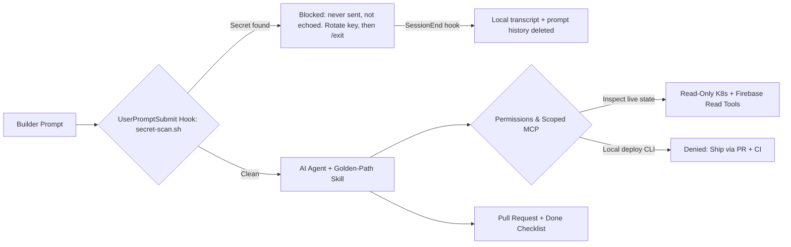
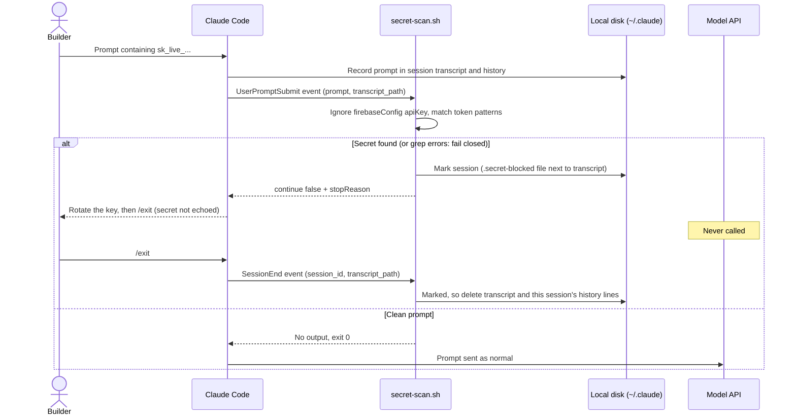

# From Vibe to Live: Building for the Real World

[](slides/)
[](#whats-inside)
[](LICENSE)

> **Companion repository for the KubeCon + CloudNativeCon North America 2026 talk by David Biel (Biel Dental Cabinets) and Trey Caliva.**

[**The Story**](#the-story-localhost-is-easy-production-has-edges) · [**How It Works**](#put-the-engineer-friend-in-the-context-window) · [**What's Inside**](#whats-inside) · [**Try It in 60 Seconds**](#try-it-in-60-seconds) · [**From Ad Hoc to Governed**](#from-ad-hoc-to-governed) · [**Slides**](slides/)

---

## The Story: Localhost Is Easy. Production Has Edges.

A cabinet maker with no engineering team vibe-coded real software that his business now runs on every day.

AI got him to `localhost` in hours. Getting to **production**—and staying there—took an engineer friend stepping in at **four edges**:

| Edge | Phase | What Vibe-Coding Defaults To | What Production Actually Needs |
| :--- | :--- | :--- | :--- |
| **Platform** | Getting live | Spinning up a raw VM or ad-hoc server | Managed services that scale to zero with nothing to patch |
| **Delivery** | Getting live | Deploying straight from a laptop | Pull requests, preview environments, and CI-only deploys from `main` |
| **Security** | Staying live | Secrets pasted in chat, `allow read, write: if true`, open endpoints | Secret managers, default-deny data rules, and auth on every endpoint |
| **Observability** | Staying live | Finding out the app is down when a customer calls | Uptime checks, error reporting, SLO alerts, and billing guardrails |

Not every builder has an engineer friend on speed dial—and in a larger org, platform engineers can't sit beside every developer prompting an agent.

**The fix: put the engineer friend directly inside the AI's context window.**

---

## Put the Engineer Friend in the Context Window

Modern coding agents give us three primitives to turn tribal production wisdom into guardrails that travel with the repo:

1. **Skills advise** — Plain-Markdown instructions the agent loads *before* writing code, encoding your golden path and a "Done checklist" it walks before finishing.
2. **Hooks & permissions enforce** — Deterministic checks that run *every single time*, blocking leaked secrets before a prompt ever leaves the laptop and denying risky tool calls like local deploys.
3. **MCP servers connect** — Live, least-privilege connections to real systems (clusters, databases, auth), granted and scoped with the same care as credentials.



### What That Looks Like in Practice

| Builder Moment | Without Guardrails | With This Repo's Setup |
| :--- | :--- | :--- |
| *"Here's our Stripe key `sk_live_...`"* | Key is sent to the model API and often written into `.env` or source | **`secret-scan.sh` blocks the prompt**. It never leaves the machine and isn't echoed back; the builder is told to rotate the key and use Secret Manager, and the session's local transcript is deleted on exit. |
| *"Just push this live right now"* | Agent runs a deploy CLI straight from the laptop | **`firebase deploy` / `gcloud run deploy` are denied**. The golden-path skill opens a branch and PR instead and explains why in plain English. |
| *"Why are orders failing?"* | Builder pastes raw prod logs or gives the agent admin credentials | **Scoped MCP** (`--read-only` K8s / read-only Firebase tool allowlist) lets the agent inspect live state safely while changes still flow through Git. |

---

## What's Inside

| Path | Role | What It Does |
| :--- | :--- | :--- |
| [`skills/golden-path/SKILL.md`](skills/golden-path/SKILL.md) | **Skill** (Serverless) | Opinionated golden path for solo builders & small teams on Firebase and Google Cloud. |
| [`skills/golden-path-kubernetes/SKILL.md`](skills/golden-path-kubernetes/SKILL.md) | **Skill** (Kubernetes IDP) | Forkable template for platform teams running an internal CNCF Kubernetes platform. |
| [`examples/claude-code/hooks/secret-scan.sh`](examples/claude-code/hooks/secret-scan.sh) | **Hook** | `UserPromptSubmit` hook that blocks prompts containing API keys, tokens, or private keys; its `SessionEnd` half deletes that session's local transcript and prompt history. |
| [`examples/claude-code/settings.json`](examples/claude-code/settings.json) | **Config & Deny Rules** | Wires up `secret-scan.sh` and denies local `firebase deploy` / `gcloud … deploy` so deploys happen in CI. |
| [`examples/claude-code/mcp.json`](examples/claude-code/mcp.json) | **Scoped MCP** | Configures `kubernetes-mcp-server` (`--read-only`) and Firebase MCP limited by `--tools` to read-only Firestore, Auth, and rules tools. |
| [`slides/`](slides/) | **Talk Deck** | Slides from the KubeCon + CloudNativeCon NA 2026 session. |

### Same Four Edges, Two Scales

Whether you're a one-person cabinet shop or a 500-engineer enterprise, **the four edges don't change—only the backing tools do**:

| Edge | [`golden-path`](skills/golden-path/SKILL.md) *(Managed Serverless)* | [`golden-path-kubernetes`](skills/golden-path-kubernetes/SKILL.md) *(Internal Platform)* |
| :--- | :--- | :--- |
| **Platform** | Firebase Hosting, Cloud Run functions, Firestore, Firebase Auth | Backstage software templates, Knative Services |
| **Delivery** | GitHub PR + Actions CI, preview channels, deploys from `main` only | GitOps with Argo CD or Flux, Cloud Native Buildpacks |
| **Security** | Secret Manager, default-deny rules, Firebase Auth + App Check | External Secrets Operator, Kyverno / OPA Gatekeeper, `NetworkPolicy` |
| **Observability** | Cloud Monitoring uptime checks + alerts, Error Reporting, budget alerts | OpenTelemetry, Prometheus `ServiceMonitor`, probes, SLO alerts |

---

## Try It in 60 Seconds

### 1. Test the secret-blocking hook right now

Clone this repo and feed a fake secret into [`secret-scan.sh`](examples/claude-code/hooks/secret-scan.sh)—no agent installation required:

```bash
# Simulated leak -> blocked before reaching the model
echo '{"prompt":"here is our key sk_live_FAKE_DEMO_KEY_9988776655"}' \
  | ./examples/claude-code/hooks/secret-scan.sh
# {"continue": false, "stopReason": "Blocked: this prompt looks like it contains
# a secret. Rotate that key now, store the new one in your secret manager, ..."}

# Normal prompt -> allowed through (no output, exit=0)
echo '{"prompt":"add a contact form"}' \
  | ./examples/claude-code/hooks/secret-scan.sh; echo "exit=$?"
# exit=0
```

#### What the hook does in a real session

The same script handles two Claude Code hook events. Blocking happens immediately; the local cleanup happens when the builder exits:



Cleanup only runs on a clean exit. If Claude Code crashes or is killed, the marked transcript stays on disk; find it with `ls ~/.claude/projects/*/*.secret-blocked` and delete the matching `.jsonl`.

### 2. Drop the guardrails into your own project

The example configs use **Claude Code**'s layout, stored without leading dots so they don't activate inside this companion repo itself. Copy them from the root of your target project:

```bash
# 1. Skill — loaded automatically when building or deploying
mkdir -p .claude/skills
cp -r path/to/from-vibe-to-live-kubecon-2026/skills/golden-path .claude/skills/

# 2. Secret-scan hook (UserPromptSubmit + SessionEnd) + deploy deny rules
mkdir -p .claude/hooks
cp path/to/from-vibe-to-live-kubecon-2026/examples/claude-code/hooks/secret-scan.sh .claude/hooks/
chmod +x .claude/hooks/secret-scan.sh
cp path/to/from-vibe-to-live-kubecon-2026/examples/claude-code/settings.json .claude/settings.json   # or merge into yours

# 3. Scoped MCP servers
cp path/to/from-vibe-to-live-kubecon-2026/examples/claude-code/mcp.json .mcp.json
```

> [!TIP]
> **Using another coding agent?** Skills are portable Markdown. Drop [`SKILL.md`](skills/golden-path/SKILL.md) into `.agents/skills/`, `.gemini/skills/`, `.cursor/rules/`, or reference it from your `AGENTS.md`—the `name` and `description` frontmatter work across modern agent harnesses.

### Production Notes

- **Swap the demo regex list for a real scanner.** [`secret-scan.sh`](examples/claude-code/hooks/secret-scan.sh) matches common token prefixes for clarity. In production, invoke [Gitleaks](https://github.com/gitleaks/gitleaks) or [TruffleHog](https://github.com/trufflesecurity/trufflehog) inside the hook.
- **Blocking isn't forgetting.** A blocked prompt never reaches the model, but Claude Code still writes it to the local session transcript (`~/.claude/projects/…`) and prompt history, where `claude --resume` or the up arrow would bring it back. That's why the hook also runs on `SessionEnd` (see the [sequence diagram](#what-the-hook-does-in-a-real-session)). It blocks with `{"continue": false}` rather than `exit 2`, because `exit 2` makes Claude Code echo the original prompt, secret included, back on screen.
- **Firebase web config isn't a secret.** The hook lets a pasted `firebaseConfig` `apiKey` through (those keys are public by design; rules and App Check protect the data) but still blocks other `AIza…` keys such as Gemini API keys.
- **Enforce read-only at both layers.** Passing `--read-only` to `kubernetes-mcp-server` hides mutating tools from the agent; pair it with a `kubeconfig` bound to a view-only Kubernetes RBAC role. Firebase MCP has no read-only switch, so [`mcp.json`](examples/claude-code/mcp.json) uses `--tools` to allowlist only read tools. `--only firestore,auth` alone would still expose `firestore_delete_database` and `auth_update_user`.
- **Deny the deploy CLIs, then remove the credentials.** [`settings.json`](examples/claude-code/settings.json) denies `Bash(firebase deploy:*)`, `Bash(gcloud run deploy:*)`, and friends, so the agent's default path is a PR. Bash deny rules match command prefixes, so they guide rather than wall off. The real backstop is that only CI (via Workload Identity Federation) holds production deploy permissions.
- **Customize the Kubernetes template.** [`golden-path-kubernetes/SKILL.md`](skills/golden-path-kubernetes/SKILL.md) uses `<placeholders>` (`<template-name>`, `<gitops-repo>`, `<registry>`, `<otel-endpoint>`)—replace them with your platform's real paved road.

---

## From Ad Hoc to Governed

Every organization climbs the same three-step curve—whether you're a two-person shop or a platform team supporting hundreds of engineers:

| Stage | How Knowledge Travels | What It Looks Like |
| :--- | :--- | :--- |
| **1. Ad hoc** | Prompts & DMs | A knowledgeable friend reviews a repo or pastes advice into chat one project at a time. |
| **2. Shared** | Team skill repository | Builders pull from a shared `skills/` repo so every coding agent loads the same paved road. |
| **3. Governed** | Curated platform catalog | Skills, hooks, and MCP servers are treated like **golden base images**: versioned, reviewed, and maintained by the platform team. |

---

## Thank You, Cloud Native Community

Even beneath an opinionated serverless stack, real-world vibe-coded apps stand on the shoulders of CNCF projects:

- **Cloud Run** implements the [**Knative Serving API**](https://knative.dev/)
- **Google Cloud Buildpacks** implement [**Cloud Native Buildpacks**](https://buildpacks.io/)
- **Event-driven functions** route events with [**CloudEvents**](https://cloudevents.io/)

---

## License

Released under the [Apache License 2.0](LICENSE).
